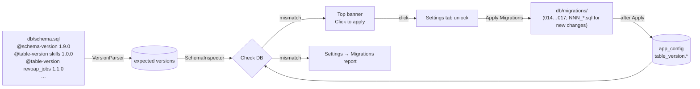

# RevoAp — Admin Settings

Since v1.4.0 RevoAp ships an in-app Settings panel that lets an
operator manage provider keys, the database connection and a handful of
runtime flags without editing `config.php` directly.

## v1.5.0 — config-driven tab visibility

Settings is gated by **two** independent layers:

1. The `SettingsTab` flag in `config.php` (default `true`).
   Comparison is strict (`=== true`); accidental truthy values do NOT
   enable the tab. Either `app.SettingsTab` or top-level `SettingsTab`
   is honored — the top-level form wins when both are set.
2. The admin token (`REVOAP_ADMIN_TOKEN` env or `.admin.key`).

When the flag is `false`, the tab is hidden in the UI and every
`/api/settings/*` endpoint replies `404 settings_disabled`. This is the
recommended posture for production deployments that have no operator
who needs in-app access; ops still ship config changes through normal
deployment pipelines.

## Threat model

Settings exposes write access to every secret RevoAp touches. The
Settings tab is therefore **disabled by default**. To turn it on the
operator must explicitly provision an admin token. The token gates every
`/api/settings/*` endpoint and every protected action in the UI.

Secrets are never echoed back. After a save the `GET /api/settings`
response only returns a masked fingerprint (`sk-o••••••••cdef`) plus
the source the key was loaded from (`file` / `env` / `config`).

## Enabling Settings

Pick **one** of the two options below. Either is sufficient.

### Option A — environment variable

```sh
export REVOAP_ADMIN_TOKEN="$(openssl rand -hex 32)"
# php-fpm / Apache / nginx must inherit the variable; for systemd:
#   systemctl edit php-fpm
#   [Service]
#   Environment=REVOAP_ADMIN_TOKEN=...
```

### Option B — `.admin.key` file at the project root

```sh
cd /var/www/revoap
umask 077
openssl rand -hex 32 > .admin.key
chown www-data:www-data .admin.key
chmod 600 .admin.key
```

`.admin.key` is git-ignored (`*.key` plus an explicit `.admin.key`
entry). Never commit it.

## Unlocking the panel

1. Reload the homepage. A `Settings` tab appears in the top navigation.
2. Click it. The lock screen prompts for the admin token.
3. Submit. The server validates with `hash_equals()` and pins an
   HttpOnly + SameSite=Strict cookie (`oc_admin`) for the next 2 hours.

You can also unlock by appending `?admin_token=...` to any URL or
sending `X-Admin-Token: ...` / `Authorization: Bearer ...` on API
requests.

## What you can change

### Providers / API keys

* OpenRouter — `https://openrouter.ai/api/v1`
* BotHub — `https://bothub.chat/api/v2/openai/v1`

For each provider the form takes a base URL, an API key and an
"Active" checkbox. **Save** writes the key to `.{provider}.key` at the
project root (0600) so the secret never lands in the JSON config nor
git. **Test** probes:

* OpenRouter — `GET /key` (returns budget metadata) with `/models`
  fallback.
* BotHub — `GET /models` (requires the key).

**Import models** pulls the live catalog. OpenRouter is public; BotHub
requires the saved key.

### Models

Active model rows drive consensus. Each row carries `provider`,
`model`, `active`. You may add empty rows manually, pick from the
recommended dropdown, or import a catalog and copy IDs over. The list
is capped at 64 rows.

### Database

Individual fields (host / port / dbname / charset / unix_socket / user
/ password) are serialized through `App\Settings\DatabaseDsn` into a
PDO DSN. **Test** opens a short-lived PDO connection and runs
`SELECT 1`. Errors are surfaced through `App\Core\ErrorDiagnostics`
exactly like `/api/debug` — no password ever appears in the response.

### Database maintenance

* **Check DB** compares the live database against `db/schema.sql`
  (tables, columns, types, NULL/NOT NULL) and adds a `Schema versions`
  section listing every table whose live version (from `app_config`)
  differs from the `@table-version` declared in `db/schema.sql`.
* **Apply Migrations** (formerly "Apply pending") runs each pending
  file under `db/migrations/` inside a `schema_migrations` tracker.
  Since v1.8.40 the schema lives entirely in `db/schema.sql` and the
  `001…013` chain is gone, but the directory is no longer empty: it
  holds `014…017`, the migrations added after the consolidation. A
  fresh import therefore needs nothing applied on top, while an
  existing deployment applies those files here. A further schema change
  ships as a new `NNN_*.sql` file (see `db/migrations/README.md`) and is
  applied the same way. "Already exists" / "duplicate column" errors are
  treated as benign and the migration is recorded as applied. After
  every successful apply, the file's `@table-version` annotations are
  written into the `app_config` table so the live DB always advertises
  the versions it actually has.
* **Migrations list** shows the `db/migrations/*.sql` set with applied /
  pending status, the table-version annotations parsed from each file,
  and a per-row **Apply** button (v1.8.27+). `applyOneByName()` rejects
  a name that does not match the `NNN_*.sql` pattern with
  `invalid_filename`.
* **Baseline** marks every pending file as already-applied without
  running it. It only matters once new migrations exist; note that
  `ReCreate DB` baselines the directory after replaying `db/schema.sql`.
  That is safe because every table a migration creates is *also* declared
  in `db/schema.sql` (including `memory_items`, see
  `db/migrations/README.md`), so the replayed schema already contains the
  table by the time the baseline is recorded.
* **Download schema dump** uses `SHOW CREATE TABLE` to produce a
  portable text dump (no `mysqldump` required).

### Schema versioning (v1.8.40+)

`db/schema.sql` is the **single source of truth**; `db/migrations/`
holds the incremental migrations (`014…017`) that converge an existing
deployment on it. RevoAp tracks the
live version of every table in the `app_config` system table. The
Settings UI surfaces drift to the operator both inline (per migration
row) and globally (a top banner is rendered on every page when versions
are out of date).



**When you change a table:**

1. Edit the table's `CREATE TABLE` block in `db/schema.sql` AND bump
   its `-- @table-version <table> <new-version>` comment (plus the
   top-of-file `-- @schema-version`).
2. If existing deployments must converge without a full
   `mysql < db/schema.sql` re-import, ship a migration under
   `db/migrations/NNN_*.sql` carrying the same
   `-- @table-version <table> <new-version>` annotation. The
   `MigrationManager` writes that version into `app_config` after a
   successful apply, so a Check DB on a live host that has applied the
   migration converges on green. New tables follow the same rule — the
   `CREATE TABLE IF NOT EXISTS …` block lives in `db/schema.sql`; the
   migration is only the incremental delivery vehicle for existing
   hosts.
3. A fresh install or a ReCreate DB needs nothing but `db/schema.sql`:
   `SchemaManager::recreate()` replays it and seeds `app_config` with
   the declared versions directly.

The convention is enforced lightly: `VersionParser::expectedFromSchema()`
falls back to the file-level `@schema-version` when a `CREATE TABLE`
block lacks an explicit `@table-version`, so a forgotten annotation
manifests as "every table reports `<app version>`" rather than a hard
failure.

### Runtime

Toggles for `app.debug`, `app.url`, `app.timezone`, model-response
cache (enabled + TTL) and pipeline switches (`parallel_l1`,
`max_roles_per_skill`). Saved values live in
`var/config/runtime.json` and are merged on top of `config.php` at
boot.

### Cache (v1.8.47)

Read-only statistics for the model response cache plus bulk
invalidation, so neither needs a shell.

| Endpoint | Body | Success |
|---|---|---|
| `GET /api/settings/cache` | — | `200` with the statistics document |
| `POST /api/settings/cache/purge` | `{"confirm":"PURGE","older_than_days":0}` | `200` with per-backend deletion counts |

`older_than_days` is optional (`0` = everything, the default) and must
be in `[0, 36500]`. The endpoint refuses with `400
confirmation_required` when the `PURGE` control word is missing and with
`400 invalid_window` for an out-of-range value — the window is validated
before anything is deleted, and the UI asks for the control word typed by
hand (the same guard as **Database → ReCreate DB**). Both endpoints use
the admin-token gate shared by every other `/api/settings/*` route, and
the counters come from the same `ModelResponseCache` methods
`bin/cache-purge.php` uses, so the UI and the CLI always agree.

What the card reports: enabled/disabled, cache format version, TTL,
entries and bytes per backend (database payload bytes plus the
`information_schema` footprint; the hierarchical `cache/` tree size) and
their paths, oldest/newest entry, the legacy flat-layout leftover count,
the hit counter (recorded hits, entries with hits, entries never hit,
last hit, hit rate) and the top provider/model rows.

The hit counter exists only in the database backend
(`model_response_cache.hits`) — the filesystem backend records nothing —
so a filesystem-only deployment reports the counter as *unavailable*
rather than as zero. A true request-level hit rate is not derivable from
the cache tables either (misses are stored nowhere): the reported rate is
the share of stored *entries* that served at least one hit, and when
entries exist but nothing has ever been served, the card says so in
amber.

A sticky strip above the sections (**Interface** … **Logout**) scrolls to
a section and highlights the one being read (`IntersectionObserver`, no
scroll handler). It is built from the sections actually present in the
DOM, so a section switched off by config is not advertised. Its height is
published as `--oc-settings-nav-height`, which both the cards
(`scroll-margin-top`) and the document scroller (`scroll-padding-top`)
use to keep a scrolled-to section — including the Worker card reached
from the header indicator — below the strip instead of under it. On
narrow screens the strip scrolls horizontally.

## Where settings live

```
.admin.key                   # admin token (0600, git-ignored)
.openrouter.key              # OpenRouter API key (0600, git-ignored)
.bothub.key                  # BotHub API key (0600, git-ignored)
var/config/runtime.json      # operator overrides (no secrets, git-ignored)
```

`Config::load()` calls `RuntimeConfig::merge()` so saved values take
effect on the next request without a PHP restart.

## nginx hardening

```nginx
location ~ ^/(\.openrouter\.key|\.bothub\.key|\.admin\.key|\.env|var/) {
    deny all;
}
```

Apache equivalent (htaccess):

```apache
<FilesMatch "^\.(openrouter|bothub|admin)\.key$|^\.env$">
    Require all denied
</FilesMatch>
RedirectMatch 403 ^/var/.*
```

## Rotating the admin token

1. Generate a new value (`openssl rand -hex 32`).
2. Replace `.admin.key` (or update the env variable and reload PHP-FPM).
3. Old browsers still hold the previous cookie; click **Lock** in the
   Settings panel or wait two hours for the cookie to expire.

## Operational notes

* Never commit any `*.key` file or `var/config/runtime.json`.
* The Settings tab is hidden in the UI when the admin token is not
  configured. The API still responds with `503 admin_not_configured`
  for any `/api/settings/*` request, so probes give zero information.
* `Logger::sanitize()` redacts every value flowing through the
  diagnostic pipeline. The Settings endpoints reuse the same sanitizer
  for error payloads.
